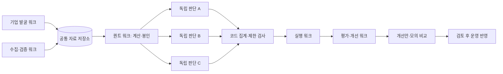

# NH자동매매 flow — 전체 설계 한 장

목표: 자료·수치·독립 검토·사후 평가를 연결해 판단을 개선한다. 고정 예산과 손절은 유지한다.

| 워크 | 하는 일 | 실행 시점 |
|---|---|---|
| 기업 발굴 | 테마·밸류체인·공식 사업/재무 근거 확인, 공통 위험 표시 | 평일 07:30 |
| 수집·검증 | 시세·뉴스·계좌를 같은 회차 자료로 고정 | 장중 매시간 요청 |
| 퀀트 | 60거래일 상대 강도 재계산·검증, 공통 입력 봉인 | 수집 완료 후 |
| 판단 A | 동일 자료로 독립 매수·매도·보유 판단 | 판단 필요 시 |
| 판단 B | A의 답을 보지 않고 동일 기준으로 독립 판단 | A와 병렬 |
| 판단 C | A/B의 답을 보지 않고 동일 기준으로 독립 판단 | A/B와 병렬 |
| 매매 실행 | 선행 위험 점검, 검증된 결정만 주문·체결 대조 | 수집 전 위험 점검 / 집계 후 주문 |
| 평가·개선 | 결과·비용·놓친 근거 검토, 다음 모의 실험 제안 | 장 종료 후 / 개선안은 주 1개 이내 |

**연결 담당은 이 대화와 기존 예약이다.** 별도 워크에 작업을 전달하고 완료를 확인한다.
수치 검사·자료 봉인·투표 집계는 코드가 수행한다. 집계용 심판 AI를 추가하지 않는다.

**공통 데이터 약속:** 원본 시각·회차·입력 해시·정책 버전이 일치해야 한다. A/B/C는 같은 불변
input.json과 퀀트 결과만 받는다. 역할 워크의 운영 기록과 별개로 매회 새 독립 판단 세션을 사용한다.
완료 응답에는 회차·작업·입력 ID를 남긴다. 자료 불일치·누락·실패·만료면 다음 단계는 보류한다.
실행 직전 현재가·예산·보유·미체결을 다시 검사한다. 승인받은 자료를 몰래 고치지 않는다.

**개선 순환:** 평가 → 개선 가설 → 별도 모의 비교 → 검토 → 운영 반영. 연구 결과가 곧 운영 규칙은 아니다.
초기에는 개선안 1개·반증·비교 방법을 기록한다. 성과 자료가 없으면 없다고 적는다.
총 100만 원·국내만·최대 5개·종목 상한 20만 원·현금 25만 원·손절 -4%·손실 10만 원 중단은 잠근다.

**현재 → 이번 진행:** 기존은 기업발굴/장중 예약과 코드 내부 단계였다. 이번에는 역할별 실제 로컬 워크,
공통 작업 명세·완료 기록·등록부를 만들고 동일 자료 전달을 검증한다. 독립 워크끼리 매시간 따로 검색하지 않는다.
사용자는 이 설계의 역할 워크 생성과 연결 담당의 작업 전달을 승인했다. 워크는 결과를 파일로 반환하고 임의로 서로 메시지를 보내지 않는다.
