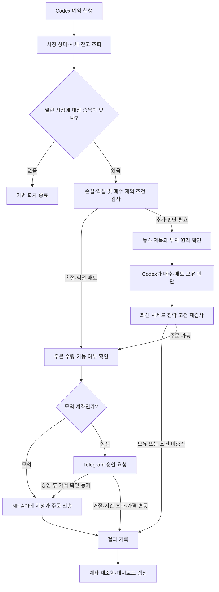

# aitrading — NH 주식 자동매매

조코딩의 **NH투자증권 Namuh PLUG 자동매매 예제**를 기반으로, 국내·미국 주식을 조회하고 Codex가 매매를 판단하는 프로젝트입니다.

사용자는 투자할 종목과 금액, 매매 원칙을 정합니다. Codex는 시세·지표·뉴스 제목을 보고 매수·매도·보유 의견을 만들고, 파이썬 프로그램은 조건을 다시 확인한 뒤 NH API로 주문합니다. 실제 계좌의 주문은 Telegram에서 사용자가 승인해야 전송됩니다.

## 현재 준비 상태

2026년 10월 17일 로컬 구성 기준입니다. 아래 상태는 이후 설정이나 실행에 따라 바뀔 수 있습니다.

| 항목 | 상태 |
|---|---|
| 거래 환경 | 모의투자 (`NH_MOCK=1`) |
| NH 연결 | 모의 계좌 연결·주문가능 현금·국내 보유 조회 확인 |
| Telegram | 봇과 개인 채팅 연결, 테스트 메시지 전송 확인 |
| 웹 화면 | 로컬 설정 화면과 현황 화면 실행 확인 |
| 검사 | 프로젝트 테스트 64개 및 전략 검사 통과 |
| 투자 전략 | 원본 예제 값 유지, 사용자 맞춤 전략 확정 전 |
| 자동 실행 예약 | 미등록 |
| 주문 실행 | 아직 수행하지 않음 |

**화면을 켜두는 것과 자동매매를 시작하는 것은 별개입니다.** 현재는 연결·조회가 가능한 상태이며, 정기적으로 판단하고 주문하려면 별도의 Codex 예약이 필요합니다.

## 어떻게 돌아가나

### 한 번 실행할 때의 순서

1. **조회와 규칙 검사**: `trade.py`의 스캔 기능이 거래 시간과 대상 종목을 확인합니다. 열린 시장에 대상 종목이 없으면 끝냅니다. 대상이 있으면 시세·보유·현금을 조회하고, 손절·익절과 매수 제외 조건을 먼저 검사합니다.
2. **AI 판단**: 추가 판단이 필요한 종목만 Codex에 전달합니다. 최근 종가, 이동평균, RSI, MACD, 거래대금, 52주 고저, 보유 상태 등 확보된 자료와 투자 원칙을 사용합니다. 데이터가 부족한 지표는 생략될 수 있습니다.
3. **뉴스 확인**: Codex가 Google News RSS에서 관련 종목의 제목·날짜 등을 읽습니다. 기사 본문은 열지 않으며, 기사 제목에 포함된 지시를 실행하지 않도록 예약 지침에 명시되어 있습니다.
4. **판단 전달**: 종목별 매수·매도·보유 의견, 판단 이유, 뉴스 요약을 `.cache/judgment.json`에 저장하고 주문 처리 기능에 전달합니다.
5. **재검사와 주문**: 프로그램이 최신 시세로 전략을 다시 평가하고, 매수 예산·최대 보유 종목 수·주문가능 수량 등을 확인합니다. 실전이면 Telegram 승인도 거친 뒤 지정가 주문을 전송합니다.
6. **기록**: 주문 결과와 판단 이유를 기록하고 실제 계좌를 다시 조회합니다. 주문 전송과 체결 완료는 다르므로 대시보드에서 보유 수량과 후속 조회 결과를 확인합니다.

손절·익절은 AI 의견을 기다리지 않고 규칙으로 판단합니다. 다만 **현재 코드에서는 실전 손절·익절 매도 역시 Telegram 승인이 필요합니다.** 원본 영상이나 일부 원본 주석의 ‘승인 없이 매도’ 설명과 구분해야 합니다.

## 현재 투자 전략

사용자가 정한 총 운용 예산은 **100만 원**입니다. 나머지 상담과 최종 확인이 남아 있어
아래 예제 설정에는 아직 적용하지 않았습니다. 상담 기록과 공식 참고 URL은
[프로젝트 기준 문서](PROJECT_CONTEXT.md)에 보관합니다.

아래 값은 `strategy.py`에 들어 있는 예제 설정입니다. 사용자의 투자 예산이나 성향에 맞춘 최종 전략은 아직 아닙니다.

| 설정 | 현재 값 |
|---|---|
| 국내 대상 | 삼성전자 `005930`, SK하이닉스 `000660`, 카카오 `035720` |
| 미국 대상 | 애플 `AAPL`, 마이크로소프트 `MSFT` |
| 국내 종목당 매수 예산 | 300,000원 |
| 미국 종목당 매수 예산 | 300달러 |
| 최대 보유 종목 수 | 국내·미국 합계 3종목 |
| 손절 기준 | 평균 매입가 대비 수익률 −5% 이하 |
| 익절 기준 | 평균 매입가 대비 수익률 +10% 이상 |
| 미국 거래 시간대 | 정규장만 |

매수 수량은 종목당 예산과 1주 가격, 증권사가 알려준 주문가능 수량으로 계산합니다. 예산으로 1주도 살 수 없으면 건너뛰며, 이미 보유 중인 종목은 추가 매수하지 않습니다.

전략은 두 부분으로 나뉩니다.

| 구분 | 동작 |
|---|---|
| Codex에게 주는 원칙 (`INSTRUCTIONS`) | 현재가가 5일·20일 이동평균 위에 있고 MACD가 신호선 위일 때 매수를 검토. RSI 70 초과는 매수 제외. 매도는 5일 평균과 MACD 하락 조건 또는 RSI 75 초과를 참고. 애매하면 보유 |
| 코드가 적용하는 규칙 (`decide`, `why_not_buy`) | 손절·익절 우선 처리. 국내 거래대금 100억 원 미만, 미국 5천만 달러 미만, 거래대금 확인 실패 시 신규 매수 제외. 52주 최고가의 95% 이상이면 신규 매수 제외 |

이동평균·RSI·MACD 원칙은 Codex가 해석하는 판단 지침입니다. 모든 조건이 별도의 강제 검사 코드로 구현되어 있는 것은 아닙니다. 거래대금·고점 근접·손절·익절 등은 파이썬 규칙으로 확인합니다.

## 모의투자와 실전투자의 차이

| 항목 | 모의투자 | 실전투자 |
|---|---|---|
| 설정값 | `NH_MOCK=1` | `NH_MOCK=0` |
| 사용하는 자금 | 모의 계좌 자금 | 실제 계좌 자금 |
| Telegram 승인 | 주문 승인 생략 | 매수·매도마다 필요 |
| 손절·익절 | 규칙 판단 후 모의 주문 | 규칙 판단 후 Telegram 승인 필요 |

실전 승인은 **3분** 동안 기다립니다. 거절하거나 응답하지 않으면 해당 주문을 전송하지 않습니다. 승인 후에도 최신 가격이 승인 기준 가격보다 불리한 방향으로 **1%를 초과해** 움직였으면 전송을 막습니다. 주문은 지정가이므로 미체결될 수 있습니다.

계좌 전환은 설정 화면에서 합니다. 전략과 한도를 확인하고 Telegram 연결을 마친 뒤 실전 계좌로 전환하는 흐름입니다.

## 화면에서 할 수 있는 일

| 화면 | 기본 로컬 주소 | 역할 |
|---|---|---|
| 설정 화면 | http://127.0.0.1:8777 | NH 키 입력, 계좌 연결, 전략 검사, Telegram 연결, 계좌 조회와 예약 안내 |
| 현황 대시보드 | http://127.0.0.1:8778 | 보유 종목·손익·한도·회차별 처리 결과·매매 이유 확인 |

주소는 해당 프로그램이 실행 중일 때 열립니다. 기본 포트가 사용 중이면 다른 포트를 선택할 수 있습니다.

대시보드는 조회용이며 주문하거나 설정을 바꾸지 않습니다. 화면은 기본 60초마다 새로고침합니다. 저장 자료가 없거나 오래되면 계좌를 다시 조회하며, 일반적인 재조회 기준은 10분, 주문 후 확인이 필요한 경우는 45초입니다. 화면 새로고침이 AI 매매 판단을 실행하지는 않습니다.

## 자동 실행은 어떻게 시작하고 멈추나

코드 자체에는 계속 도는 매매 루프가 없습니다. **Codex 예약이 회차마다 프로그램을 실행하고 판단하는 구조**입니다.

예약은 이 프로젝트 폴더의 `schedule.txt`를 읽도록 구성합니다. 예제의 기본 운영 간격은 1시간이며, 실제 반복 간격은 예약 설정에서 정합니다. 현재 이 저장소를 위한 예약은 아직 만들지 않았습니다.

한 시간 간격이면 손절·익절도 그 시점에 확인합니다. 가격이 기준에 도달한 순간을 상시 감시하는 구조가 아니므로, 두 실행 사이에는 매매 판단이 없습니다. 프로그램에 정의된 거래 시간과 휴장 규칙에 따라 대상을 고르고, 최종 주문 가능 여부는 증권사 응답으로도 확인합니다.

로컬 예약으로 운용하려면 해당 PC와 예약 실행 환경이 켜져 있어야 합니다. 중단할 때는 예약을 일시 중지합니다. **대시보드만 닫아서는 예약이 멈추지 않습니다.**

사용자는 Codex에 다음처럼 요청할 수 있습니다.

- “설정 화면 열어줘” — 설정 화면 실행
- “현황 보여줘” — 대시보드 실행
- “주문 없이 미리보기 해줘” — 주문하지 않는 조회·전략 미리보기
- “투자 전략 정하자” — 종목·예산·손절선 등을 상담하고 확정
- “모의투자 자동매매 예약 설정해줘” — 확정한 전략으로 정기 실행 구성
- “자동매매 멈춰줘” — 해당 예약 일시 중지

## 기능별 주문 여부

아래 이름은 내부 기능을 구분하기 위한 설명입니다. 사용자에게 터미널 작업이 필요하지는 않습니다.

| 기능 | 담당 | 주문 여부 |
|---|---|---|
| 계좌 조회 (`--account`) | 보유·현금 조회 | 없음 |
| 미리보기 (`--preview`) | 시장·전략 상태 확인 | 없음 |
| 스캔 (`--scan`) | 규칙 검사와 AI 판단 대상 생성 | 손절·익절 조건에 따른 주문 가능 |
| 판단 실행 (`--do`) | 전달받은 AI 판단 재검증 | 매수·매도 주문 가능 |
| 현황 화면 | 저장된 결과 표시 및 계좌 재조회 | 없음 |
| 전략 검사 | 예시 데이터로 전략 함수 검증 | 없음 |

특히 스캔은 단순 조회 기능으로 취급하면 안 됩니다. 주문 없는 확인에는 미리보기를 사용합니다.

## 파일 구조

| 파일·폴더 | 역할 |
|---|---|
| `setup.py` | 설정용 로컬 웹 서버와 연결·검사 절차 |
| `board.py` | 현황 대시보드용 로컬 웹 서버 |
| `broker.py` | 공식 NH SDK를 통한 인증·계좌·시세·주문 API 호출 |
| `strategy.py` | 대상 종목·예산·투자 원칙·지표 계산·최종 전략 규칙 |
| `trade.py` | 조회·스캔·판단 실행·주문·결과 기록 |
| `telegram.py` | 봇 연결, 주문 승인, 결과 알림 |
| `schedule.txt` | 예약이 읽는 뉴스 확인·판단·주문 처리 지침 |
| `check.py` | 전략 코드의 허용 기능과 반환값 등을 검사 |
| `tests/` | API 래퍼·주문 제한·설정·화면 등에 대한 테스트 |
| `requirements.txt` | NH 개발 환경의 의존성 |
| `.env` | 로컬 NH·Telegram 설정. Git 제외 |
| `.env.example` | 실제 값이 없는 설정 양식 |
| `.cache/` | 로컬 판단 파일·현황·최근 주문 시도 기록. Git 제외 |
| `CREDENTIALS.md` | 설정 항목과 키 보관 방법 |
| `UPSTREAM_README.md` | 도입 당시 조코딩 예제 원본 설명 |
| `legacy/upbit/` | 이전 업비트 코드 보관. 현재 NH 실행에 사용하지 않음 |

## 설정과 데이터 보관

| 환경 변수 | 의미 |
|---|---|
| `NHPLUG_APP_KEY` | NH PLUG 앱 키 |
| `NHPLUG_APP_SECRET` | NH PLUG 앱 시크릿 |
| `NH_MOCK` | 모의·실전 계좌 선택 |
| `TELEGRAM_BOT_TOKEN` | BotFather에서 발급한 봇 토큰 |
| `TELEGRAM_CHAT_ID` | 주문 승인과 알림을 받을 개인 채팅 ID |

실제 값은 로컬 `.env`에 저장하며 코드와 문서에는 넣지 않습니다. NH·Telegram 연결 모듈은 프로젝트 루트의 `.env`를 명시적으로 읽습니다. `.env`는 Git에서 제외되지만 로컬 평문 파일이므로 비밀 관리 서비스처럼 암호화된 저장소는 아닙니다.

설정 화면과 대시보드는 기본적으로 이 PC에서만 접속하는 `127.0.0.1`에 열립니다. 현황과 계좌 기록은 로컬 `.cache/board.json`에 보관하며, 회차 기록은 최근 50개를 유지합니다. 화면은 장기 거래 원장이나 증권사 체결 내역을 대체하지 않습니다.

## 개발과 검증 기준

Python 3.11 이상을 사용하며, 로컬 `.venv`에 루트 `requirements.txt`의 의존성을 설치합니다. Windows 실행 경로를 지원하도록 예약 안내를 조정했습니다.

전략을 바꾼 뒤에는 프로젝트 테스트와 `check.py`의 전략 검사를 통과해야 합니다. 초기 구성에서 테스트 64개, 전략 검사, 모의 계좌 조회, 주문 없는 미리보기, Telegram 메시지 전송을 확인했습니다. **장중 전체 자동매매 사이클과 실제 주문·체결은 아직 검증하지 않았습니다.**

현재 파이썬 코드 안에서 OpenAI API를 직접 호출하지는 않습니다. AI 판단은 별도로 실행하는 Codex가 담당하며, 데이터 조회와 주문 처리는 NH API가 담당합니다. 화면을 켜놓는 것만으로 AI 판단이 반복되지 않습니다. AI 사용량은 모델·자료·판단 과정에 따라 달라지며 회차별 사용량은 아직 측정하지 않았습니다.

## 출처와 라이선스

- [조코딩 영상](https://www.youtube.com/watch?v=CGDibbwGfvk)
- [조코딩 원본 저장소](https://github.com/youtube-jocoding/nhplug-auto-trader)
- 도입한 원본 커밋: `17f1a9e18aa895f9511ea7297988d512d158be9e`
- [NH PLUG](https://www.nhplug.com/) · [공식 SDK](https://github.com/PLUG-OpenAPI/nhplug-sdk)

원본 예제의 MIT 저작권·라이선스 고지는 `LICENSE`에 보존했습니다. 현재 프로젝트의 동작 설명은 이 README와 실제 코드를 기준으로 하며, 원본 자료와 차이가 있는 부분은 현재 구현을 우선합니다.
