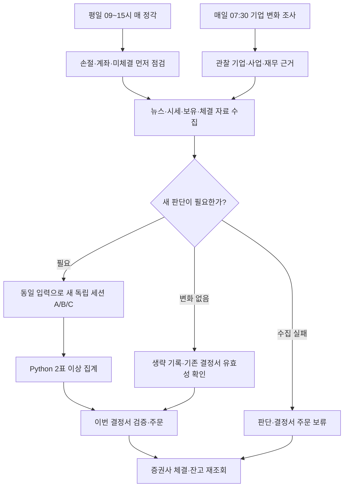

# aitrading — NH 국내 주식 모의 자동매매

조코딩의 NH투자증권 Namuh PLUG 예제를 바탕으로, 밸류체인 기업을 조사하고 독립 세 AI의
의견을 집계해 매매하는 프로젝트입니다. 사용자가 정한 예산·위험 제한은 AI가 바꾸지 않습니다.

## 전체 흐름

**매일 기업 변화 조사 → 매시간 위험 점검·자료 수집 → 필요할 때 독립 세 판단 → 주문 → 체결 확인**

기업을 찾는 일, 데이터를 모으는 일, 투자 판단, 주문 처리는 서로 다른 단계입니다.
단계를 같은 시각에 따로 실행하면 이전 자료를 잘못 쓸 수 있어, 장중 작업은 한 예약 안에서 순서대로 연결합니다.

### 1. 매일 기업 발굴·변화 조사

평일 07:30 ‘NH 기업발굴’이 기업의 공시·사업·재무 변화를 조사합니다. 미검증 기업과 보유 기업을
우선하고 심층 보완은 회차당 최대 3개입니다. 전체 테마와 목록 검토는 7일마다 하며 매일 전부 교체하지 않습니다.

테마 → 밸류체인 → 부품·기술 → 실제 국내 기업 → 매출·수주·재무 근거 순서로 조사합니다.
관찰 기업은 3개 테마의 15~25개이고 실제 보유는 최대 5개입니다. 관찰 기업 수를 맞추려고 매수하지 않습니다.

후보 목록은 `research/universe.json`, 조사 설명은 `research/discovery.md`입니다.
`watch`는 관찰·검증 대상이고 `eligible`은 공식 사업·재무 자료 충족 표시입니다. eligible도 매수 결정은 아닙니다.
출처를 실제로 읽은 시각을 기록하며, 날짜만 바꿔 재검증한 것처럼 만들지 않습니다.
전체 검토 시각 `full_reviewed_at`을 일일 조사 시각과 분리해 주간 검토가 계속 미뤄지지 않게 합니다.

### 2. 매시간 위험 점검과 데이터 수집

장중 회차는 AI보다 먼저 보유 종목의 -4% 손절, 계좌 손실, 체결·미체결을 확인합니다.
이후 관찰·보유 기업의 최신 뉴스 제목·발행일, NH 시세·지표, 계좌·주문 상태를 한 입력에 저장합니다.
뉴스는 Google News RSS의 최근 24시간 제목을 기업별 최대 5개 수집하며 기사 본문을 읽었다고 주장하지 않습니다.

뉴스 검색 결과 없음과 조회 실패를 구분합니다. 시세나 필요한 뉴스 수집에 실패하면 새 판단과 결정서 주문을
보류합니다. 후보 목록에서 제외된 보유 기업도 위험 점검과 뉴스 수집에서 빠뜨리지 않습니다.

`collection.py`는 불변 input.json 저장을 끝낸 뒤 `.cache/collection.json`에 완료 표식을 게시합니다.
선정에는 당일 수집 후 90분 안의 완료본만 사용하며, 선정 시각으로 수집 시각을 덮어쓰지 않습니다.

### 3. 필요할 때만 독립 세 AI 판단

다음 중 하나가 있으면 새 독립 판단을 요청합니다.

- 유효한 이전 결정서가 없거나 만료됨
- 뉴스·공시·사업·재무 근거 또는 보유·검증 완료 기업의 구성이 바뀜
- 마지막 실제 AI 판단 가격 대비 누적 2% 이상 변동
- 이동평균·RSI·MACD·거래대금·고점 근접 등 기존 조건이 바뀜
- 보유 수량·체결·취소·계좌 위험 상태가 바뀜
- 아직 실행되지 않은 매매 의견 또는 21일 재평가 대상이 있음

2%는 AI 재검토를 부르는 운영 기준이며 손절·예산 한도를 바꾸는 값이 아닙니다.
보유 기업도 검증 완료 기업도 없으면 AI 호출을 생략합니다. 변화가 없어 생략한 회차도 따로 기록하며
새로운 ‘보유’ 표를 받은 것처럼 표시하지 않습니다. 수집 시각만 달라진 것은 새 근거로 세지 않습니다.

판단이 필요하면 과거 대화를 넘기지 않은 새 세션 A/B/C가 같은 입력만 읽습니다. 서로의 답을 보거나 추가
검색을 하지 않습니다. 세 응답 모두 유효할 때 2표 이상 일치하면 채택하고, 셋이 갈리면 보유합니다.
응답 실패·누락은 보유와 구분해 주문을 보류합니다. 집계는 Python이며 네 번째 심판 AI는 없습니다.

매수 금액·가격 상한은 찬성자 중 작은 값입니다. 전체 여력 안에서 매수 표가 많은 기업부터 배정하고
동률은 종목코드 순서입니다. 결정서는 입력·투표 원문·근거·행동·금액·가격 상한·만료를 함께 보관합니다.
같은 모델과 자료의 공통 오류는 남습니다. 세션 ID와 해시는 로컬 감사 기록이며 암호학적 실행 증명은 아닙니다.

### 4. 제한 검사와 매매 실행

`cycle.py`가 이번 수집본·판단 필요성 검사·결정서를 연결해 확인합니다. 새 판단이 필요했는데 실패하면
이전 매수 의견으로 대신 주문하지 않습니다. 판단을 생략한 회차는 일치하는 기존 결정서만 유효기간 안에서 사용합니다.

결정서는 수집 입력 생성 후 당일 최대 8시간과 15:20 중 빠른 시각까지 유효합니다. 실행 시 현재가·예산·
보유 수·미체결·계좌·환경·고정 제한을 다시 검사합니다. 입력 시세의 1% 이내 및 판단자가 정한 더 낮은
매수 가격 상한을 넘으면 사지 않습니다. 보유 종목 추가 매수는 하지 않습니다.

같은 결정서·기업으로 주문을 재전송하지 않습니다. 주문 전송은 체결 완료가 아니며 증권사 후속 조회로 확인합니다.
-4% 손절은 투표보다 우선합니다. 고정 +10% 익절이나 4주 강제 매도는 없고 근거 약화·재평가로 매도합니다.

### 5. 미체결과 취소

확인된 당일 모의 주문이 접수 후 1시간 이상 미체결이면 남은 수량만 한 번 취소 요청합니다.
부분 체결분은 유지하고 취소가 증권사 조회에서 확정되기 전까지 잔량의 예산과 보유 자리를 계속 예약합니다.

주문 접수가 불명확하거나 취소 응답을 받지 못하면 재전송하지 않습니다. 확인이 필요한 상황은 알립니다.
실전·이전 거래일 주문은 자동 취소하지 않습니다. 취소 후 손절 기준이 계속 충족되면 다음 점검에서 다시
수량·가격을 확인하며, 일반 매매는 새 판단을 거칩니다. 취소 확인 전에 재주문하지 않습니다.
취소 별도 내역 등으로 주문 대조가 모호해져도 원장을 임의 보정하지 않고 신규 매수를 중단합니다.

## 사용자 고정 제한

| 항목 | 값 |
|---|---|
| 시작 환경 | 모의투자, 국내 주식만 |
| 총 운용 예산 | 1,000,000원 |
| 실제 보유 | 최대 5개, 강제 매수 없음 |
| 종목당 신규 투자 | 최대 200,000원, 기본 검토액 150,000원에서 유동 배분 |
| 현금 기준 | 250,000원, 미체결·비용 예약 포함 |
| 개별 손절 | 평균 매입가 대비 -4% 이하 |
| 계좌 손실 중단 | 운용자산 900,000원 이하에서 신규 매수 중단·알림, 자동 재개 없음 |
| 보유 근거 재평가 | 매수·마지막 재평가 후 21일, 최신 근거가 유효하면 연장 |
| 관찰 범위 | 3개 테마, 중복 없는 15~25개 기업 |

모의 계좌의 큰 잔액을 예산으로 쓰지 않습니다. 초기 계좌 순자산 변화만 100만 원 운용자산에 반영하며
실현·평가손익과 계좌에 반영된 비용을 포함합니다. 다른 매매가 없는 전용 국내 계좌를 전제로 합니다.
별도 주문·보유·설명되지 않는 입출금이 발견되면 신규 매수를 중단하고 기준점을 자동 초기화하지 않습니다.
비용 대비 주문 금액의 1%를 추가 예약하며 이는 실제 수수료율이 아닙니다.
계좌 손실 중단은 전량 청산이 아니며 이미 접수된 주문의 취소 확정도 별도로 확인해야 합니다.

## 예약과 화면

| 예약 | 시간·역할 |
|---|---|
| NH 기업발굴 | 평일 07:30, 일일 변화 조사·주간 전체 검토 |
| NH 자동매매 | 평일 09~15시 매 정각, 위험→수집→필요 시 판단→실행→체결 확인 |
| 이전 NH 기업선정 | 중지. 장중 회차의 판단 단계로 통합해 중복 실행 방지 |

매매 예약은 이 프로젝트의 `schedule.txt`를 가리킵니다. 실행 중에는 새 코드를 작성하거나 고정 전략을 바꾸지 않습니다.
멈추려면 NH 자동매매 예약을 일시 중지합니다. 기업 조사도 멈추려면 NH 기업발굴도 중지합니다.
대시보드만 닫아서는 예약이 멈추지 않습니다. 이 PC와 앱이 켜져 있어야 로컬 예약이 실행됩니다.
손절은 상시 감시가 아닌 시간 단위 점검이므로 정확히 -4%에 체결되는 것을 보장하지 않습니다.
공휴일은 별도 달력으로 자동 판별하지 않으며 증권사 응답으로도 최종 확인합니다.

| 화면 | 주소 |
|---|---|
| 설정 | http://127.0.0.1:8777 |
| 현황 | http://127.0.0.1:8778 |

현황은 조회용입니다. 마지막 실제 AI 의견과 이번 판단 요청·생략·실패, 보유·한도·미체결을 구분해 보여줍니다.
화면 새로고침은 AI 판단이나 주문을 실행하지 않습니다. 사용자가 명령을 입력하거나 파일을 직접 고칠 필요가 없습니다.

실전 전환은 별도 사용자 지시와 전략 확인·설정 화면 절차가 필요합니다. 실제 계좌의 매수·매도는 손절도
Telegram 승인을 받아야 하며 3분 무응답·거절이면 주문하지 않습니다. 승인 후 불리한 가격 변동이 1%를 넘으면
주문을 막습니다. 현재 예약과 자동 잔량 취소는 모의 전용입니다. 키는 설정 화면에서 사용자가 직접 입력합니다.

## 주요 파일

| 파일 | 역할 |
|---|---|
| strategy.py · INVESTMENT_POLICY.md | 고정 한도·투자 원칙 |
| discovery-task.md · research.py | 일일 기업 변화 조사·후보 검증·주간 검토 기준 |
| collection-task.md · news.py · collection.py | 장중 뉴스·시세·계좌 수집·완료본 게시 |
| cycle.py | 판단 필요성 검사·회차와 결정서 연결 |
| research-task.md · voter-instructions.md · voting.py | 조건부 독립 판단·투표 검증·집계 |
| schedule.txt · trade.py · managed.py · broker.py | 순차 회차·예산·체결·주문·미체결 관리 |
| board.py · setup.py · telegram.py | 현황·설정·알림·실전 승인 |
| research/universe.json | 출처가 있는 관찰 후보, 현재 초기 15개는 모두 watch |
| research/discovery.md · collection.md · selection.md | 일일 조사·수집·선정 설명 |
| .cache/ | 시세·뉴스·입력·투표·결정서·점검·운용 원장. Git 제외 |
| .env | 로컬 NH·Telegram 설정. Git 제외, 채팅에도 게시하지 않음 |
| PROJECT_CONTEXT.md | 상담 기록·공식 참고 URL·운영 상태 |
| legacy/upbit/ | 이전 업비트 원본 보관, NH 실행에 사용하지 않음 |

## 검증과 출처

투자 실효성과 두 참고 영상의 적용은 [실효성 검토·검증 계획](research/reviews/2026-10-18-effectiveness-review.md)에
따로 정리했습니다. 기능 테스트 통과는 수익 우위의 증명이 아니며, 조건부 성과·손익비·대조군 검증은 아직 계획 단계입니다.

Python 3.11 이상, 로컬 .venv와 루트 requirements.txt를 사용합니다. 프로젝트 테스트 135개와 전략 검사를
통과했습니다. 모의 계좌·시세 조회, 독립 세 세션 투표, 수집 분리, 조건부 생략 경로를 실제로 확인했습니다.
뉴스 수집 확인에서 15개 기업·42개 제목·조회 실패 0개였습니다. 현재 사업·재무 검증 완료 기업은 0개라
AI 호출과 신규 주문을 생략했습니다. 이는 매시간 새 보유 표를 받았다는 뜻이 아닙니다.

부분 체결·취소·응답 유실·중복 주문·한도·판단 실패 처리는 테스트로 검증했습니다.
실제 장중 주문·체결·취소의 전체 연결은 아직 미검증이며 수익을 보장하지 않습니다.
Python이 OpenAI API를 직접 호출하지 않습니다. 예약의 Codex가 필요한 세 독립 판단을 실행합니다.
판단 묶음당 기본 3회, 일일 조사와 장중 회차 관리의 사용량은 별도이며 실제 한도 소모율은 미측정입니다.

- 조코딩 원본: https://github.com/youtube-jocoding/nhplug-auto-trader
- 원본 도입 커밋: 17f1a9e18aa895f9511ea7297988d512d158be9e
- 원본 설명 UPSTREAM_README.md와 MIT LICENSE 보존
- NH 공식 문서: https://www.nhplug.com/llms.txt · https://www.nhplug.com/llms-full.txt
- NH SDK: https://github.com/PLUG-OpenAPI/nhplug-sdk
- Telegram: https://t.me/BotFather · https://core.telegram.org/bots/api
